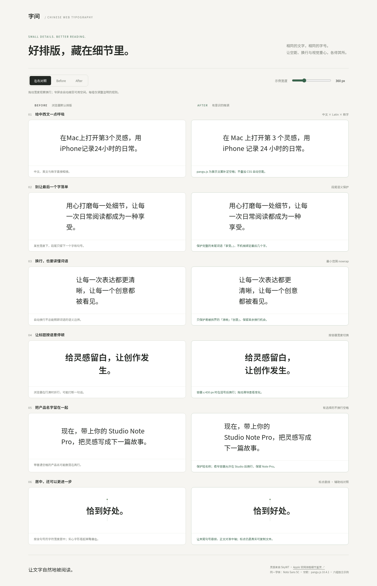

# Chinese Web Typography

让中文网页的空距、换行与视觉重心更自然。一个可复用的 agent skill，附带可离线打开的 before / after 排版实验室。

灵感来自 SkyWT 的文章 [《Apple 官网排版细节鉴赏》](https://skywt.cn/blog/apple-typography-details)。本仓库提炼排版判断方法，不使用 Apple 的私有字体。示例文案为本仓库编写。

## 安装 skill

将本仓库作为一个完整的 skill 目录，放到支持 `SKILL.md` 的 agent 的技能目录中。例如 Codex：

```sh
git clone https://github.com/Skywt2003/chinese-web-typography.git ~/.codex/skills/chinese-web-typography
```

已有本地 clone 时，也可以将它软链接到技能目录。然后使用：

```text
使用 $chinese-web-typography 检查这个中文页面的排版。
重点处理混排空距、标题断行和段尾孤字，保留原文，并在手机和桌面宽度下验证。
```

核心规则在 [SKILL.md](SKILL.md)，pangu.js 的精确 API 与 SSR 接入在 [references/pangu.md](references/pangu.md)。加载 skill 不需要先安装 Node 依赖；依赖仅用于开发 demo、跑测试，以及目标项目选择接入 pangu 时。

## 打开 demo

直接打开 **[demo/index.html](demo/index.html)**，无需构建、安装依赖或联网。GitHub 文件页展示的是源码；下载仓库后在浏览器打开 HTML。

- 左右对照、单独 Before、单独 After 三种视图。
- 260–600 px 容器宽度滑块，小屏会自动收缩。
- 六个独立案例：混排空距、段尾孤字、语义断词、响应式标题、产品名保护、标点视觉居中。
- 支持 `?view=after&width=400`，便于固定条件复现。
- Before 和 After 使用同一字体、字号及原文；第一项由真实 pangu.js 处理，其余是可读的 HTML/CSS 编辑实例。



[Before](screenshots/before.png) · [After](screenshots/after.png) · [Mobile comparison](screenshots/mobile-comparison.png)

## 本地开发与验证

需要 Node.js 22+、pnpm，以及 Playwright 的 Chromium：

```sh
pnpm install --frozen-lockfile
pnpm exec playwright install --no-shell chromium
pnpm demo                 # http://127.0.0.1:4173
pnpm test                 # Node 字符串测试 + Playwright 实际布局测试
pnpm screenshots          # 更新 screenshots/ 下的四张截图
```

Linux CI 若缺少浏览器系统库，使用 `pnpm exec playwright install --with-deps --no-shell chromium`。

测试覆盖真实字符串转换、幂等性、服务端/浏览器字符串结果一致、技术字段保留、切换视图、响应式断点、受保护词语的行框、标点居中以及多个视口宽度下的文本溢出。测试结果不代表已验证所有操作系统和浏览器；字体视觉判断仍需人工查看。

Demo 不是全站自动改写器。pangu.js 只接管第一组明确指定的展示文案，其他规则由 agent 根据实际内容和渲染决定是否应用。

## 依赖与许可

- 仓库原创代码和 skill：MIT，见 [LICENSE](LICENSE)。
- pangu.js **10.4.1**：MIT，精确锁定；使用 `spaceText`，不沿用旧版的 `spacing` API。
- Noto Sans SC / Fontsource **5.3.1**：SIL OFL 1.1。Demo 附带简体中文的 400、600 字重。
- 上游分发文件及许可位于 [demo/vendor](demo/vendor/)。运行 `pnpm vendor` 可从锁定的依赖重新生成。

原文链接用于注明灵感来源；本仓库 MIT 许可不改变原文章的许可。
